# V2V Communication System

**Two-way vehicle-to-vehicle radio link for blind mountain bends, with a live browser dashboard.**

**Team:** Sanmugavel B, Vasantharaj G and Gokul Anand A


On a hairpin bend, the hill hides each driver from the other. This project gives two vehicle units a direct radio link that needs no tower or internet. Each unit shares its speed and motion data, and the dashboard warns when the vehicle beyond the bend brakes hard.

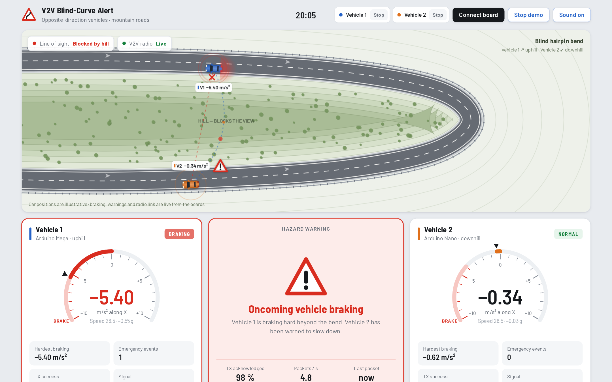
<sub>Dashboard in demo mode, using simulated data. Car positions are illustrative.</sub>

## Highlights

- **Two-way link:** Vehicle 1 sends a packet about once a second, and Vehicle 2 replies with its own.
- **Reliable delivery:** the nRF24L01 handles acknowledgements, CRC checks and up to 15 automatic retries.
- **Fault tolerant:** if a motion sensor fails, the unit flags it and keeps the radio link running.
- **Live dashboard:** a single HTML file reads the boards over USB, with no install or server.

## System overview

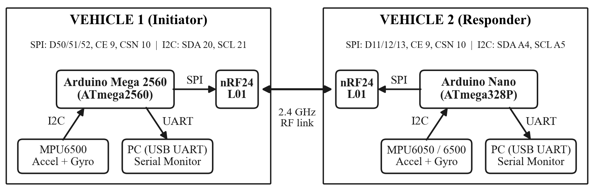

| Unit | Controller | Motion sensor | Role |
|---|---|---|---|
| Vehicle 1 | Arduino Mega 2560 | MPU6500 (register-level I2C) | Starts each exchange, then waits 250 ms for the reply |
| Vehicle 2 | Arduino Nano | MPU6050 (Adafruit library) | Listens, then answers each packet |

### Hardware

| Vehicle 1: Mega | Vehicle 2: Nano |
|---|---|
| 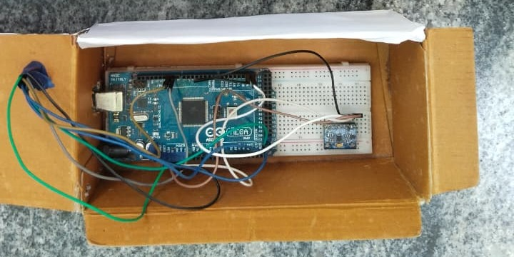 | 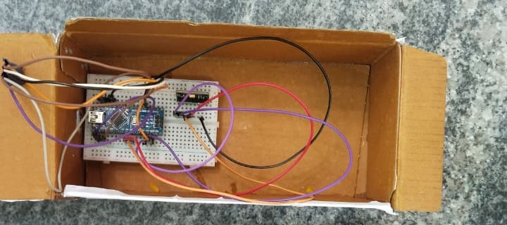 |

### Project photos

**Assembled units**

| Front | Top |
|---|---|
| 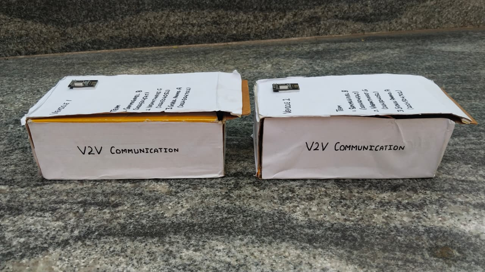 | 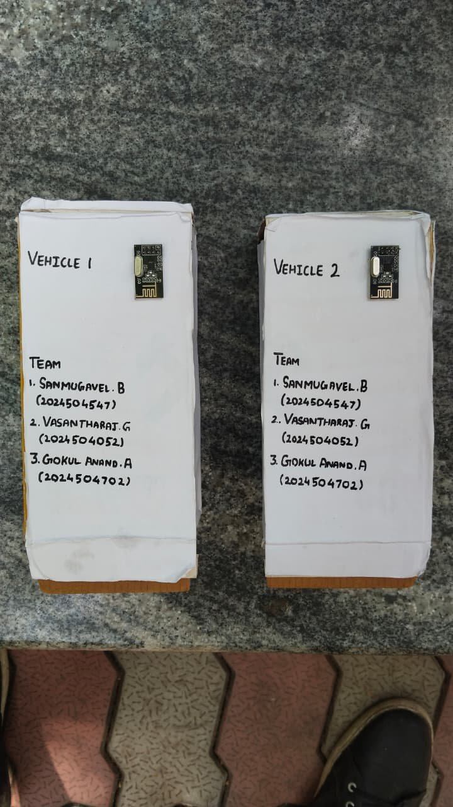 |
| 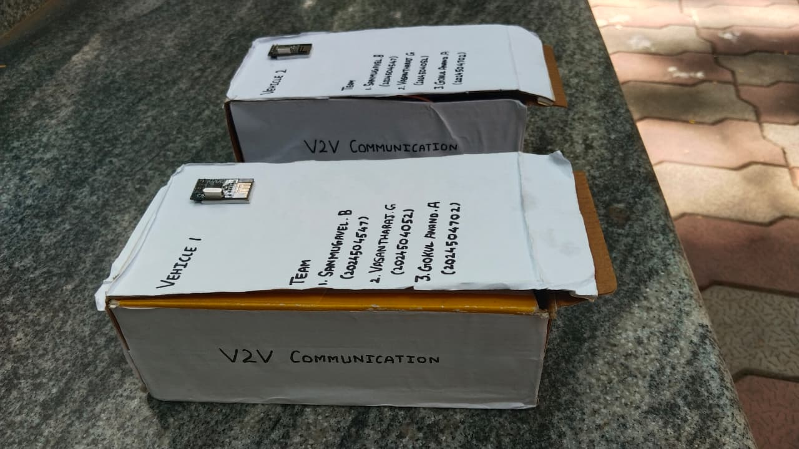 | 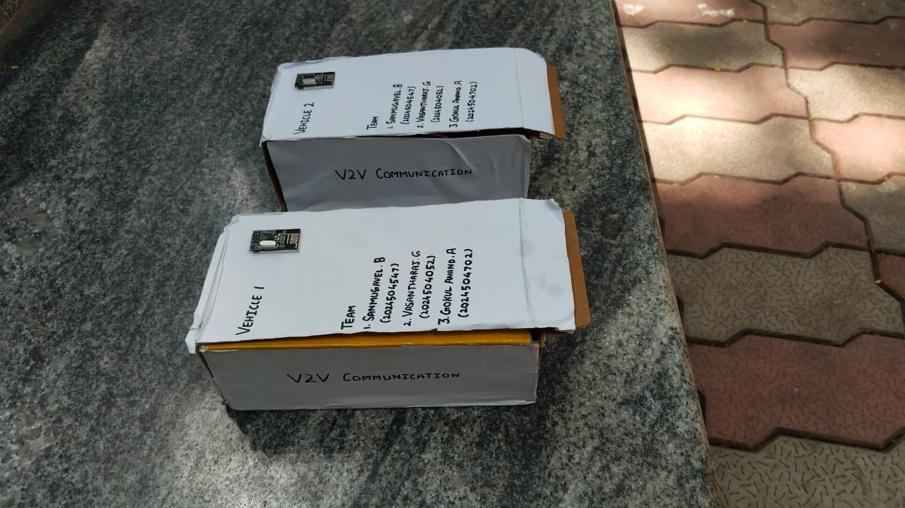 |

**Inside the units**

| | |
|---|---|
| 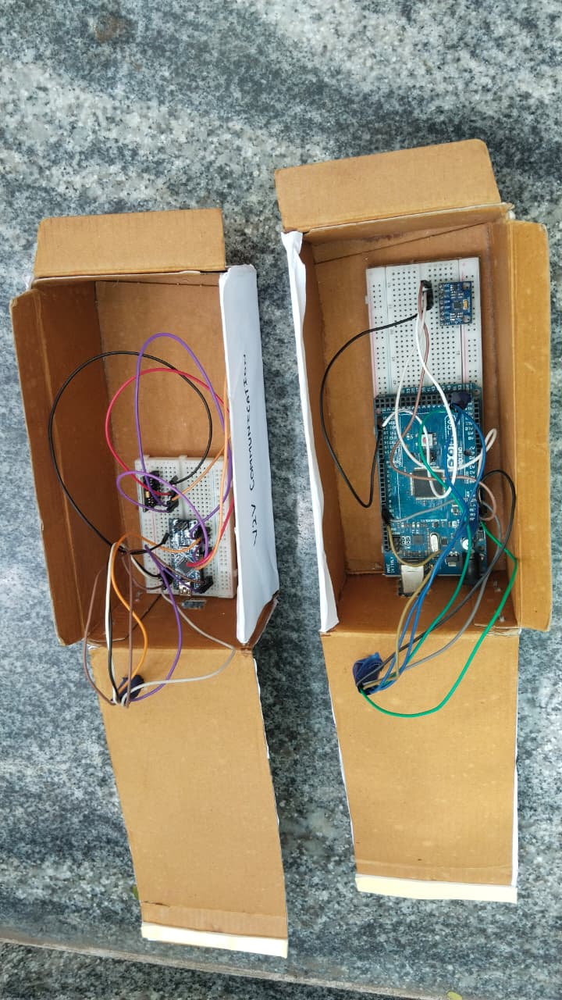 | 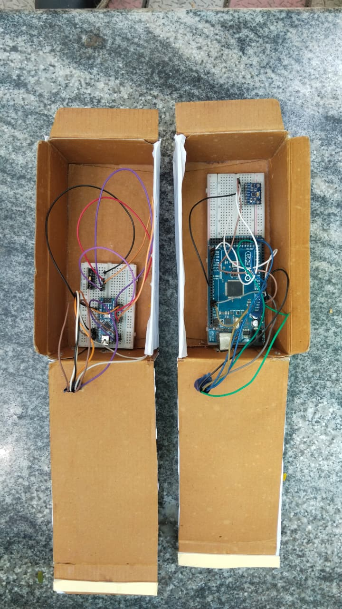 |
| 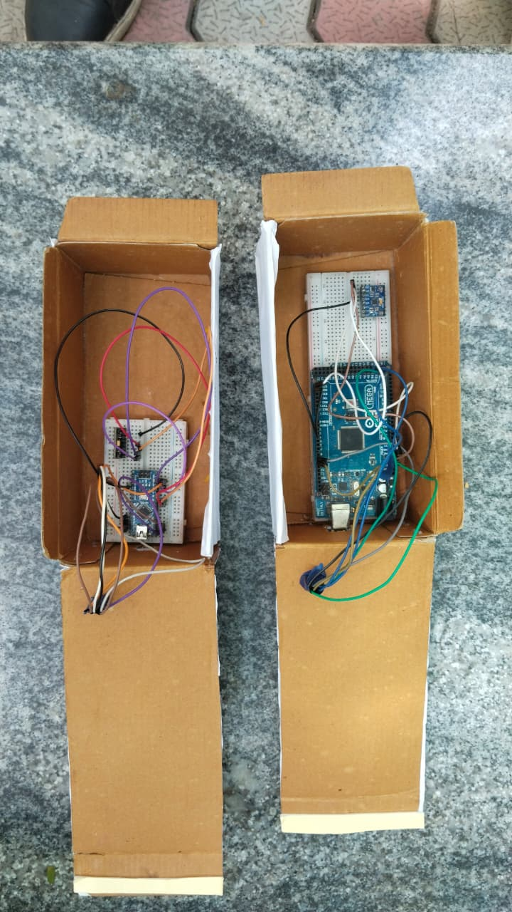 | 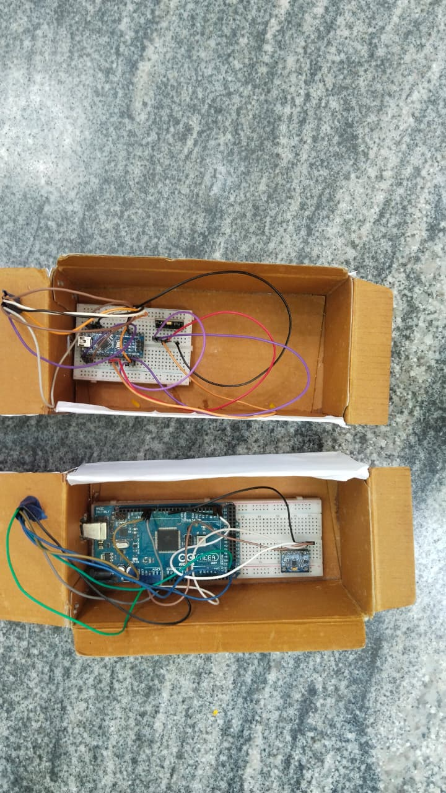 |

### Program flow

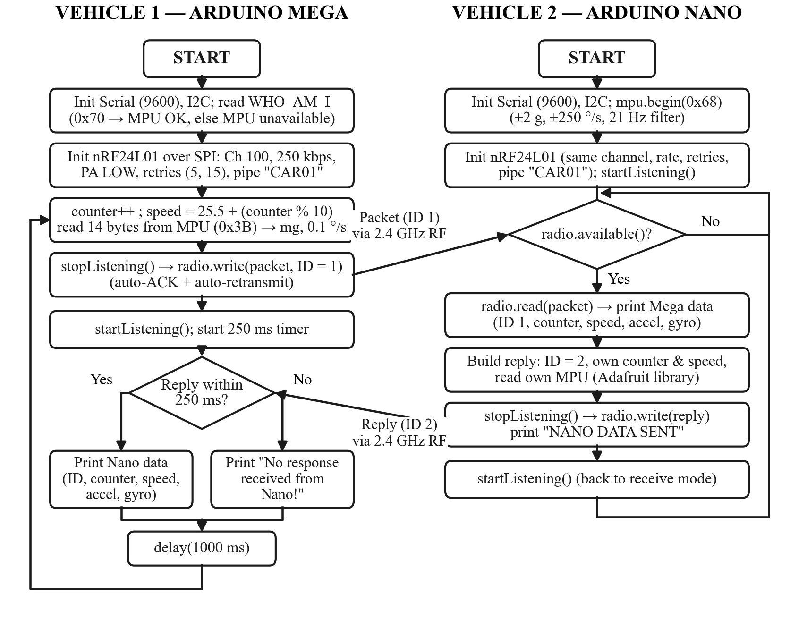

## Communication details

| Link | Bus | Configuration |
|---|---|---|
| Vehicle to vehicle | 2.4 GHz RF | Channel 100, 250 kbps, low power, address `CAR01` |
| Controller to radio | SPI | CE on D9, CSN on D10 |
| Controller to sensor | I2C | Address `0x68`, ±2 g, ±250 °/s |
| Controller to PC | UART over USB | 9600 baud |

### Data packet (20 bytes)

| Field | Type | Bytes | Meaning |
|---|---|---|---|
| `vehicleID` | `uint8_t` | 1 | 1 = Mega, 2 = Nano |
| `counter` | `uint16_t` | 2 | Packet number |
| `speed` | `float` | 4 | km/h (demo value, see [limitations](#current-limitations)) |
| `mpuPresent` | `uint8_t` | 1 | 1 = sensor OK |
| `ax_mg`, `ay_mg`, `az_mg` | `int16_t` × 3 | 6 | Acceleration in milli-g |
| `gx_dps10`, `gy_dps10`, `gz_dps10` | `int16_t` × 3 | 6 | Rotation rate in 0.1 °/s |

## Wiring

Power the nRF24L01 from **3.3 V only**.

| Signal | Mega 2560 | Nano |
|---|---|---|
| nRF24 CE | D9 | D9 |
| nRF24 CSN | D10 | D10 |
| nRF24 SCK | D52 | D13 |
| nRF24 MOSI | D51 | D11 |
| nRF24 MISO | D50 | D12 |
| MPU SDA | D20 | A4 |
| MPU SCL | D21 | A5 |

## Dashboard

Normal driving, with both vehicles shown on the bend:

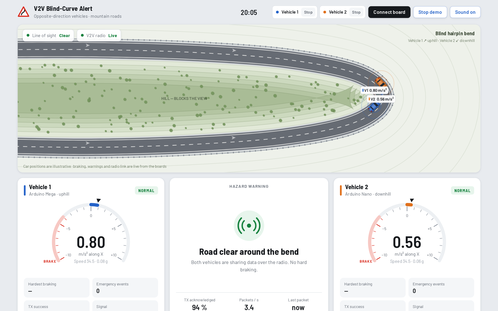

The dashboard raises a hazard warning when a vehicle's X-axis acceleration falls below **−4.0 m/s²**. It also shows gauges, link quality, a live graph and an event log.

## Getting started

1. Install these libraries from the Arduino Library Manager: **RF24**, **Adafruit MPU6050** and **Adafruit Unified Sensor**.
2. Upload `firmware/vehicle1_mega` to the Mega and `firmware/vehicle2_nano` to the Nano.
3. Open `dashboard/index.html` in Chrome or Edge on a computer. Other browsers can't read USB serial.
4. Click **Connect board** and choose a board's serial port, or click **Demo** to try it without hardware.

## Repository structure

```text
V2V-Communication-System/
├── firmware/
│   ├── vehicle1_mega/vehicle1_mega.ino    Vehicle 1 sketch
│   └── vehicle2_nano/vehicle2_nano.ino    Vehicle 2 sketch
├── dashboard/index.html                   Web Serial dashboard
└── docs/
    ├── Project_Report.pdf                 Full project report
    └── images/                            Diagrams, screenshots and hardware/ photos
```

## Current limitations

- **Speed is a demo value.** The sketches generate it from the packet counter, because there is no wheel-speed sensor yet.
- **Braking is detected in the dashboard.** The sketches share motion data but don't run any alert logic themselves.
- **Car positions are illustrative.** The units have no GPS, so the map shows the scenario and not real locations.
- **The dashboard has only been tested in demo mode.** It has not yet been verified with live boards connected.
- **Vehicle 1's acceleration reaches the dashboard through Vehicle 2.** The Mega doesn't print its own readings, so its motion data only appears when the Nano is connected.

## Future scope

- Run braking detection on the vehicle units, with a buzzer and LED warning
- Add a real wheel-speed sensor and GPS position
- Port the firmware to a PIC16F877A using its MSSP and USART modules

## Project report

The full write-up is in [docs/Project_Report.pdf](docs/Project_Report.pdf). This was built as a mini project for **EC23020 PIC Microcontrollers**. The hardware uses Arduino boards, and the report relates its SPI, I2C and UART use to the PIC course material.

## Team

**Sanmugavel B**, **Vasantharaj G** and **Gokul Anand A**

Department of Electronics and Communication Engineering, Madras Institute of Technology, Anna University, Chennai
